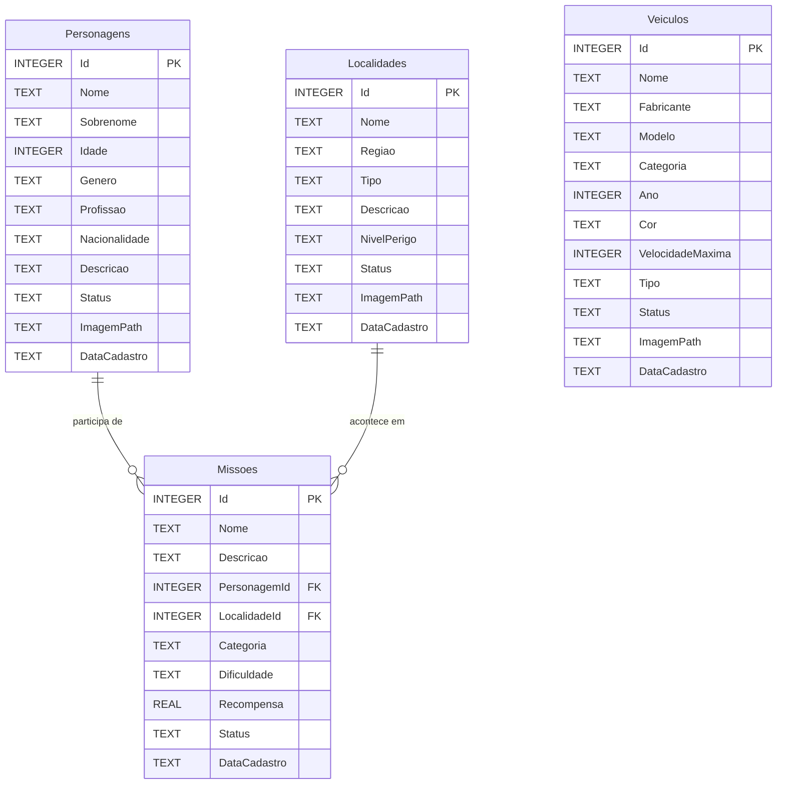

<div align="center">


# Vice City Central — GTA VI Management System

**Projeto Final de Programação Orientada a Objetos I**

Sistema desktop em **C# / .NET 8 (Windows Forms)** com banco de dados **SQLite**, inspirado no universo de *Grand Theft Auto VI*.
Uma central administrativa para gerenciar **personagens, veículos, missões e localidades** de Vice City e do estado de Leonida.

   


</div>

---

## Sumário

1. [Descrição](#descrição)
2. [Objetivo](#objetivo)
3. [Tecnologias utilizadas](#tecnologias-utilizadas)
4. [Funcionalidades](#funcionalidades)
5. [Requisitos para execução](#requisitos-para-execução)
6. [Instalação](#instalação)
7. [Como executar](#como-executar)
8. [Estrutura das pastas](#estrutura-das-pastas)
9. [Arquitetura e Programação Orientada a Objetos](#arquitetura-e-programação-orientada-a-objetos)
10. [Banco de dados](#banco-de-dados)
11. [Validações e tratamento de erros](#validações-e-tratamento-de-erros)
12. [Atendimento aos requisitos acadêmicos](#atendimento-aos-requisitos-acadêmicos)
13. [Imagens das telas](#imagens-das-telas)
14. [Integrantes do grupo](#integrantes-do-grupo)
15. [Créditos e aviso legal](#créditos-e-aviso-legal)

---

## Descrição

O **Vice City Central** simula o painel administrativo de uma organização que opera em Vice City. A interface usa tema escuro com tons de preto, grafite e roxo e detalhes em rosa neon, azul‑turquesa e lilás, com cards, gráficos, ícones e botões com efeito ao passar o mouse.

Todos os dados ficam gravados em um banco **SQLite** e permanecem salvos após fechar e abrir o programa.

## Objetivo

Aplicar os conceitos de **Programação Orientada a Objetos** (encapsulamento, herança, polimorfismo e abstração) em um sistema completo com interface gráfica, persistência em banco de dados, operações **CRUD**, validações e organização em camadas.

## Tecnologias utilizadas

| Tecnologia | Uso |
|---|---|
| **C# 12 / .NET 8** | Linguagem e plataforma |
| **Windows Forms** | Interface gráfica (controles próprios desenhados com GDI+) |
| **SQLite** + `Microsoft.Data.Sqlite` | Banco de dados local |
| **ADO.NET** | Acesso a dados com consultas parametrizadas |
| **Git / GitHub** | Versionamento |
| **Material Design Icons** | Ícones (licença Apache 2.0) |

## Funcionalidades

### Navegação
- Menu lateral (**sidebar**) com 6 itens: Dashboard, Personagens, Veículos, Missões, Localidades e Configurações.
- Cada item abre sua própria tela dentro da janela principal, sem sobrepor janelas.
- Atalhos de teclado: `Ctrl+1` … `Ctrl+6` (módulos), `Ctrl+N` (novo), `Ctrl+S` (salvar), `Ctrl+E` (editar), `Delete` (excluir), `Esc` (cancelar), `Ctrl+F` (pesquisar), `F5` (atualizar).
- Ao sair de uma tela com alterações não salvas, o sistema pede confirmação.

### Dashboard
- Cards com **total de personagens, veículos, missões e localidades**, **missões concluídas** e **missões pendentes** (disponíveis + em andamento).
- **Gráfico de barras** de veículos por categoria e **gráfico de rosca** de missões por status.
- **Últimos registros adicionados** (clique para abrir o registro no módulo correspondente).
- **Atalhos** para cadastrar personagens, veículos, missões e localidades.
- **Data e hora** atualizadas automaticamente e atualização periódica dos indicadores (configurável).
- Todos os números são consultados no banco de dados.

### Módulos de cadastro (Personagens, Veículos, Missões e Localidades)
Cada módulo possui:
- Botões **Novo**, **Salvar**, **Editar**, **Excluir**, **Cancelar** e **Detalhes**.
- **Pesquisa por nome** (com atualização automática enquanto digita).
- **Filtros** específicos e botão **Limpar filtros**.
- **Listagem** com miniatura da imagem e status em destaque colorido.
- **Visualização detalhada** em janela própria (botão Detalhes, duplo clique ou `Enter`).
- **Imagem** do registro (Personagens, Veículos e Localidades): selecionar, trocar ou remover. A imagem escolhida é copiada para a pasta do sistema.

| Módulo | Campos | Pesquisa e filtros |
|---|---|---|
| **Personagens** | ID, nome, sobrenome, idade, gênero, profissão/ocupação, nacionalidade, descrição, status (Ativo/Inativo/Procurado), imagem | Nome; status |
| **Veículos** | ID, nome, fabricante fictício, modelo, categoria, ano, cor, velocidade máxima, tipo, status (Disponível/Em uso/Apreendido), imagem | Nome, modelo ou fabricante; categoria; status |
| **Missões** | ID, nome, descrição, personagem relacionado, localidade, categoria, dificuldade, recompensa fictícia, data de cadastro, status | Nome; categoria; dificuldade; status |
| **Localidades** | ID, nome, região, tipo de local, descrição, nível de perigo, status, imagem | Nome; região; tipo |

### Configurações
- Nome do sistema, versão, informações do projeto e créditos dos desenvolvedores.
- Preferências: nome do operador, segundos no relógio, atualização automática do Dashboard e intervalo, linhas alternadas nas listagens e notificações de sucesso.
- **Limpar filtros** de todas as telas.
- **Restaurar configurações padrão**.
- Abrir a pasta do banco e **restaurar o banco de dados inicial**.

## Requisitos para execução

- **Windows 10 ou 11** (Windows Forms é exclusivo do Windows).
- **[.NET 8 SDK](https://dotnet.microsoft.com/download/dotnet/8.0)** para compilar e executar.
- Opcional: **Visual Studio 2022** (17.8 ou superior) com a carga de trabalho *Desenvolvimento para desktop com .NET*.
- Conexão com a internet apenas na **primeira compilação**, para baixar o pacote `Microsoft.Data.Sqlite` do NuGet.

Não é necessário instalar o SQLite: a biblioteca nativa já vem no pacote NuGet.

## Instalação

```bash
git clone https://github.com/<seu-usuario>/VICE-CITY-CENTRAL.git
cd VICE-CITY-CENTRAL
dotnet restore
```

## Como executar

**Pelo terminal**

```bash
dotnet run --project ViceCityCentral.csproj
```

**Pelo Visual Studio**

1. Abra o arquivo `VICE-CITY-CENTRAL.sln`.
2. Pressione `F5` (ou *Depurar › Iniciar*).

**Gerar um executável para distribuir (opcional)**

```bash
dotnet publish ViceCityCentral.csproj -c Release -r win-x64 --self-contained true -o publicacao
```

O executável `publicacao/ViceCityCentral.exe` roda em computadores sem o .NET instalado. Copie a pasta inteira, porque ela inclui `Assets` e `Database`.

**Primeira execução:** o banco `Database/vice_city.db` é criado automaticamente, ao lado do executável, a partir do script `Database/vice_city.sql`, já com os dados iniciais. Para recomeçar do zero, use *Configurações › Restaurar banco de dados inicial* ou apague o arquivo `.db`.

## Estrutura das pastas

```
VICE-CITY-CENTRAL/
│
├── Assets/
│   ├── Images/            # logo e ilustrações dos personagens, veículos e localidades
│   │   ├── Personagens/
│   │   ├── Veiculos/
│   │   └── Localidades/
│   ├── Icons/             # ícones PNG (coloridos em tempo de execução) e app.ico
│   └── Backgrounds/       # fundos da sidebar e do banner do Dashboard
│
├── Models/                # entidades e regras de validação (domínio)
│   ├── Interfaces.cs          IEntidade, IValidavel, IPossuiImagem, IDetalhavel
│   ├── EntidadeBase.cs        classe abstrata raiz
│   ├── EntidadeComImagem.cs   classe abstrata intermediária
│   ├── Personagem.cs · Veiculo.cs · Missao.cs · Localidade.cs
│   ├── Enums.cs · EnumExtensions.cs · Filtros.cs · Configuracoes.cs
│
├── Data/                  # infraestrutura do banco
│   ├── DatabaseConnection.cs      abre conexões (com chaves estrangeiras ativas)
│   ├── DatabaseInitializer.cs     cria/restaura o banco a partir do .sql
│   └── DataReaderExtensions.cs    leitura tipada das colunas
│
├── Repositories/          # acesso a dados (SQL) — um repositório por tabela
│   ├── IRepository.cs · RepositoryBase.cs
│   ├── PersonagemRepository.cs · VeiculoRepository.cs
│   ├── MissaoRepository.cs · LocalidadeRepository.cs · ConfiguracaoRepository.cs
│
├── Services/              # regras de negócio
│   ├── ServiceBase.cs
│   ├── PersonagemService.cs · VeiculoService.cs · MissaoService.cs · LocalidadeService.cs
│   ├── DashboardService.cs · ConfiguracaoService.cs · ImagemService.cs
│   └── AppInfo.cs · RegistroErros.cs
│
├── Exceptions/            # ValidacaoException, RegraNegocioException, DatabaseException
│
├── Views/                 # interface gráfica
│   ├── MainForm.cs                janela principal + sidebar
│   ├── ModuloBaseForm.cs          base de todas as telas
│   ├── ModuloCrudForm.cs          tela de cadastro genérica (CRUD)
│   ├── DashboardForm.cs · PersonagensForm.cs · VeiculosForm.cs
│   ├── MissoesForm.cs · LocalidadesForm.cs · ConfiguracoesForm.cs
│   ├── DetalhesForm.cs            visualização detalhada
│   ├── Components/                botões neon, cards, gráficos, diálogos, campos
│   └── Theme/                     paleta, tipografia e carregamento de recursos
│
├── Database/
│   └── vice_city.sql      # estrutura + dados iniciais (usado para criar o banco)
│
├── docs/screenshots/      # imagens das telas
├── Program.cs
├── ViceCityCentral.csproj
├── VICE-CITY-CENTRAL.sln
└── README.md
```

## Arquitetura e Programação Orientada a Objetos

O código é separado em camadas. A interface **não** acessa o banco diretamente:

```
Views (Forms)  →  Services (regras de negócio)  →  Repositories (SQL)  →  Data (conexão)  →  SQLite
        ↘──────────────── Models (entidades e validações) ────────────────↙
```

### Encapsulamento
- Propriedades com **campos privados** e setters que **normalizam** os dados (remoção de espaços extras).
- Setters que **protegem o estado**: `Personagem.Idade`, `Veiculo.VelocidadeMaxima` e `Missao.Recompensa` rejeitam valores negativos; `EntidadeBase.Id` não aceita IDs negativos.
- Detalhes internos das telas (estado de edição, imagem pendente etc.) ficam privados na classe base.

### Herança
```
EntidadeBase (abstrata)
├── EntidadeComImagem (abstrata)  → Personagem, Veiculo, Localidade
└── Missao

RepositoryBase<T> (abstrata)  → PersonagemRepository, VeiculoRepository, MissaoRepository, LocalidadeRepository
ServiceBase<T> (abstrata)     → PersonagemService, VeiculoService, MissaoService, LocalidadeService
ModuloBaseForm (abstrata)     → DashboardForm, ConfiguracoesForm, ModuloCrudForm<T>
ModuloCrudForm<T> (abstrata)  → PersonagensForm, VeiculosForm, MissoesForm, LocalidadesForm
GraficoBase (abstrata)        → GraficoBarras, GraficoRosca
```
A herança elimina código repetido. Por exemplo, as quatro telas de cadastro compartilham layout, pesquisa, botões, estados (novo/editando/visualizando), imagem e tratamento de erros em `ModuloCrudForm<T>`.

### Polimorfismo
- `Validar()` → cada entidade sobrescreve `ValidarCampos()` com suas regras (ex.: categoria *Barcos* exige tipo *Aquático*; missão *Concluída* exige um personagem).
- `ObterDetalhes()` → cada entidade estende a lista da classe base (uso de `base.ObterDetalhes()`); a **mesma** `DetalhesForm` exibe qualquer entidade.
- `Titulo`, `Subtitulo`, `StatusDescricao` e `NivelStatus` → o Dashboard mostra os **últimos registros** em uma única lista de `EntidadeBase` com personagens, veículos, missões e localidades juntos, cada um se descrevendo à sua maneira.
- `ServiceBase.VerificarPossibilidadeExclusao()` → Personagem e Localidade impedem a exclusão quando existem missões vinculadas.
- `RepositoryBase` (*Template Method*) → as classes derivadas fornecem apenas o SQL e o mapeamento das colunas.
- `GraficoBase.Desenhar()` → barras e rosca desenham-se de forma diferente sobre a mesma base.

### Abstração
- **Interfaces**: `IEntidade`, `IValidavel`, `IPossuiImagem`, `IDetalhavel`, `IRepository<T>` e `IModuloView` (contrato entre a janela principal e as telas).
- **Classes abstratas**: `EntidadeBase`, `EntidadeComImagem`, `RepositoryBase<T>`, `ServiceBase<T>`, `ModuloBaseForm`, `ModuloCrudForm<T>` e `GraficoBase`.

## Banco de dados

O script [`Database/vice_city.sql`](Database/vice_city.sql) contém a estrutura completa e os dados iniciais (9 personagens, 10 veículos, 10 localidades e 10 missões). Ele pode ser executado manualmente com `sqlite3 vice_city.db < Database/vice_city.sql`.



**Integridade referencial**
- `Missoes.PersonagemId → Personagens.Id` e `Missoes.LocalidadeId → Localidades.Id` com `ON DELETE RESTRICT`: não é possível excluir um personagem ou uma localidade que tenha missões vinculadas.
- `PRAGMA foreign_keys = ON` em todas as conexões.
- Restrições `CHECK` para valores permitidos (status, categorias, idade, velocidade, recompensa) e `UNIQUE` (sem diferenciar maiúsculas/minúsculas) contra duplicidades.
- Uma tabela auxiliar `Configuracoes` (chave/valor) guarda as preferências do usuário.

## Validações e tratamento de erros

| Situação | Comportamento |
|---|---|
| Campos obrigatórios vazios | Lista com todos os campos pendentes |
| Texto em campo numérico | Digitação bloqueada; valores colados são validados |
| Idade, velocidade ou recompensa negativas | Bloqueadas pelo encapsulamento da entidade |
| Faixas inválidas (idade 1–120, ano 1900–ano seguinte, velocidade 1–800 km/h) | Mensagem explicativa |
| Registro duplicado | Bloqueado no serviço e no banco (`UNIQUE`) |
| Exclusão | Sempre pede confirmação |
| Exclusão de registro com vínculos | Mensagem informando quantas missões estão vinculadas |
| Cadastro ou atualização bem-sucedidos | Notificação de sucesso |
| Falha de conexão ou arquivo do banco ausente | Mensagem clara (e registro em `logs/erros.log`) |
| Imagem inválida (formato ou > 10 MB) | Mensagem explicativa |
| Erro inesperado | Capturado globalmente, exibido de forma amigável e registrado em log |

## Atendimento aos requisitos acadêmicos

| Requisito | Onde |
|---|---|
| Sistema em C# com interface gráfica | .NET 8 + Windows Forms |
| Individual ou em grupo de até 5 integrantes | Ver [Integrantes](#integrantes-do-grupo) |
| Projeto em repositório Git, com código e imagens | Este repositório (`Assets/`) |
| Arquivo `.sql` do banco de dados | `Database/vice_city.sql` |
| CRUD completo (Create, Read, Update, Delete) | Personagens, Veículos, Missões e Localidades |
| Menu com pelo menos 4 itens | Sidebar com 6 itens |
| Cada item abre uma tela diferente | 6 telas: Dashboard, Personagens, Veículos, Missões, Localidades e Configurações |
| Pelo menos 4 telas novas além da principal | 6 telas + janela de detalhes |

## Imagens das telas

| Dashboard | Personagens |
|---|---|
|  |  |
| **Cadastro de personagem** | **Detalhes** |
|  |  |
| **Veículos** | **Missões** |
|  |  |
| **Localidades** | **Configurações** |
|  |  |
| **Validação de campos** | |
|  | |

> As capturas foram geradas em ambiente de testes. No Windows, o sistema usa as fontes *Segoe UI* e *Bahnschrift*, então a tipografia pode variar um pouco.

## Integrantes do grupo

| Nome | RA | GitHub |
|---|---|---|
| Integrante 1 | 125454 | @jota_codex |


> Atualize também a lista `AppInfo.Desenvolvedores` em `Services/AppInfo.cs`, exibida na tela de Configurações.

## Créditos e aviso legal

- Projeto acadêmico, sem fins lucrativos, desenvolvido para a disciplina de Programação Orientada a Objetos I.
- *Grand Theft Auto*, *GTA VI*, *Vice City* e *Leonida* são marcas da **Rockstar Games / Take-Two Interactive**. Este projeto não tem relação com essas empresas.
- Todas as ilustrações, o logotipo e os fundos foram **criados especialmente para este projeto** (arte original em estilo *synthwave*). Nenhuma imagem oficial do jogo foi usada. O usuário pode cadastrar imagens próprias pelo sistema, desde que tenha o direito de usá-las.
- Ícones: [Material Design Icons](https://pictogrammers.com/library/mdi/) — licença Apache 2.0.
- Os nomes de personagens, veículos e locais fazem referência ao universo do jogo; idades, descrições, valores e missões são fictícios.
